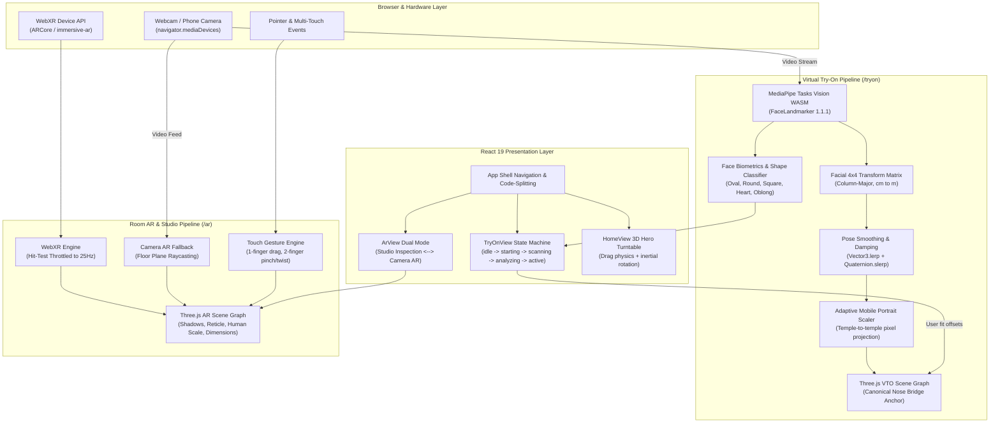

# How It Works: Architectural & Logic Deep-Dive

> Comprehensive technical guide detailing the algorithms, 3D math, computer vision pipelines, state machines, and source code of the **Slow and Curious** spatial commerce engine.

---

## Table of Contents
1. [End-to-End System Architecture](#1-end-to-end-system-architecture)
2. [Dev Environment & Secure Context (`vite.config.ts`)](#2-dev-environment--secure-context)
3. [Application Shell & Routing (`src/app/App.tsx`)](#3-application-shell--routing)
4. [Catalog & Type System (`src/shared/types.ts` & `catalog.ts`)](#4-catalog--type-system)
5. [Eyewear Virtual Try-On Engine (`src/features/tryon/engine/index.ts`)](#5-eyewear-virtual-try-on-engine)
   - 5.1 MediaPipe Pipeline Initialization
   - 5.2 Transformation Matrix & Canonical Nose Bridge Anchoring
   - 5.3 Fallback Landmark Geometry & Pinhole Depth Estimation
   - 5.4 Adaptive Face-Width Auto-Scaling for Mobile
   - 5.5 Biometric Face Diagnostic & Shape Classification Algorithm
   - 5.6 Procedural Fallback Glasses & GLTF Model Caching
6. [Virtual Try-On UI & State Machine (`src/features/tryon/ui/TryOnView.tsx`)](#6-virtual-try-on-ui--state-machine)
7. [WebXR AR Engine Core (`src/features/ar/engine/index.ts`)](#7-webxr-ar-engine-core)
   - 7.1 WebXR Session Initialization
   - 7.2 Hit-Testing Throttling & Pose Interpolation
   - 7.3 Mobile WebGL GPU Optimizations
8. [Room AR & 3D Studio (`src/features/ar/ui/ArView.tsx`)](#8-room-ar--3d-studio)
   - 8.1 Dual-Mode Architecture (Studio vs. Camera AR)
   - 8.2 Floor Plane Raycasting
   - 8.3 Mobile Multi-Touch Gesture Recognizer (Drag, Pinch, Twist)
   - 8.4 Photo Snapshot Compositor
9. [AR Visual Helpers & Material System (`src/features/ar/ui/arHelpers.ts`)](#9-ar-visual-helpers--material-system)
   - 9.1 1.75m Parametric Human Silhouette
   - 9.2 Real-World Metric Dimension Bounding Box
   - 9.3 Upholstery Material Swapper
10. [Interactive 3D Turntable Home (`src/features/home/HomeView.tsx`)](#10-interactive-3d-turntable-home)

---

## 1. End-to-End System Architecture

The following diagram illustrates how video frames, computer vision models, Three.js scene graphs, WebXR hardware, and React UI layers interact across the platform:



---

## 2. Dev Environment & Secure Context

### File: `vite.config.ts`

```typescript
import { defineConfig } from 'vite';
import react from '@vitejs/plugin-react';
import basicSsl from '@vitejs/plugin-basic-ssl';

export default defineConfig({
  plugins: [react(), basicSsl()],
  // host: true exposes the dev server on LAN: https://<laptop-ip>:6969
  server: { host: true, port: 6969 },
  build: {
    rollupOptions: { input: { main: 'index.html' } },
  },
});
```

### Why this matters:
- **`basicSsl()`**: Modern web browsers mandate a **Secure Origin (HTTPS)** to unlock hardware sensors:
  - `navigator.mediaDevices.getUserMedia` (Webcam access).
  - `navigator.xr.requestSession('immersive-ar')` (WebXR AR sessions).
  Without HTTPS, mobile browsers will block camera and AR access completely.
- **`host: true`**: Binds Vite to `0.0.0.0`, enabling devices on the local Wi-Fi network (such as Android smartphones and iPhones) to connect directly via `https://<laptop-ip>:6969`.

---

## 3. Application Shell & Routing

### File: `src/app/App.tsx`

The root component configures code-splitting, accessible navigation, and client-side routing.

```typescript
const HomeView = lazy(() => import('../features/home/HomeView'));
const TryOnView = lazy(() => import('../features/tryon/ui/TryOnView'));
const ArView = lazy(() => import('../features/ar/ui/ArView'));

export default function App() {
  return (
    <BrowserRouter>
      <div className="shell">
        <a className="shell-skip" href="#main-content">Skip to content</a>
        <Navigation />
        <div id="main-content" tabIndex={-1}>
          <Suspense fallback={<PageLoader />}>
            <Routes>
              <Route path="/" element={<HomeView />} />
              <Route path="/tryon" element={<TryOnView />} />
              <Route path="/ar" element={<ArView />} />
              <Route path="*" element={<NotFound />} />
            </Routes>
          </Suspense>
        </div>
        <Footer />
      </div>
    </BrowserRouter>
  );
}
```

### Logic Highlights:
- **Dynamic Code-Splitting (`React.lazy` + `Suspense`)**: Heavy 3D and AI packages (Three.js and MediaPipe Tasks Vision) are loaded on-demand. When navigating to `/`, the heavy AR and computer vision WASM bundles are not fetched until the user visits `/tryon` or `/ar`.
- **Accessible Skip Links**: An accessible skip link (`.shell-skip`) allows keyboard and screen reader users to skip repeated navigation bars.

---

## 4. Catalog & Type System

### Files: `src/shared/types.ts` & `src/shared/catalog.ts`

These files define the strict data contracts between the UI, engines, and JSON catalogs.

```typescript
// src/shared/types.ts
export interface Frame {
  id: string;      // e.g. "frame-01"
  name: string;    // e.g. "Pilot Sunglasses"
  model: string;   // e.g. "/assets/frames/frame-01.glb"
  thumb: string;   // e.g. "/assets/thumbs/frame-01.png"
}

export interface Furniture {
  id: string;      // e.g. "item-01"
  name: string;    // e.g. "Mango Velvet Chair"
  category: "furniture" | "decor";
  model: string;   // e.g. "/assets/furniture/item-01.glb"
  thumb: string;
  size: { w: number; h: number; d: number }; // Dimensions in real-world meters
}
```

### Catalog Fetchers (`src/shared/catalog.ts`):
```typescript
export async function loadFrames(): Promise<Frame[]> {
  const res = await fetch('/catalog/frames.json');
  if (!res.ok) throw new Error(`Failed to load frames: ${res.status}`);
  return res.json();
}

export async function loadFurniture(): Promise<Furniture[]> {
  const res = await fetch('/catalog/furniture.json');
  if (!res.ok) throw new Error(`Failed to load furniture: ${res.status}`);
  return res.json();
}
```

---

## 5. Eyewear Virtual Try-On Engine

### File: `src/features/tryon/engine/index.ts`

This file is the computer vision and 3D mathematical core of the glasses try-on system.

### 5.1 MediaPipe Pipeline Initialization

```typescript
// 1. Initialize WASM fileset
const fileset = await FilesetResolver.forVisionTasks(
  'https://cdn.jsdelivr.net/npm/@mediapipe/tasks-vision@1.1.1/wasm'
);

// 2. Instantiate FaceLandmarker with facial transformation matrices enabled
faceLandmarker = await FaceLandmarker.createFromOptions(fileset, {
  baseOptions: {
    modelAssetPath: '/models/face_landmarker.task',
  },
  runningMode: 'VIDEO',
  outputFacialTransformationMatrixes: true,
  numFaces: 1,
  minFaceDetectionConfidence: 0.35,
  minFacePresenceConfidence: 0.35,
  minTrackingConfidence: 0.35,
});
```

- Loads the MediaPipe compiled WebAssembly runtime from CDN.
- Loads the local `/models/face_landmarker.task` TFLite model with automatic fallback to Google Cloud Storage.
- `outputFacialTransformationMatrixes: true` requests the direct 4×4 pose transformation matrix of the head.

---

### 5.2 Transformation Matrix & Canonical Nose Bridge Anchoring

MediaPipe calculates face landmarks against a canonical 3D face model centered in the middle of the skull. Eyeglasses rest on the nose bridge between **Landmark 168 (Glabella)** and **Landmark 6 (Nose Bridge)**:

```typescript
const NOSE_BRIDGE_CANONICAL = new THREE.Vector3(
  0,      // X: Centered horizontally
  0.029,  // Y: +2.9 cm above head origin (resting on the nose bridge)
  0.058   // Z: +5.8 cm forward (resting on the bridge surface)
);
```

#### Matrix Conversion Logic:
```typescript
if (results.facialTransformationMatrixes && results.facialTransformationMatrixes.length > 0) {
  const data = results.facialTransformationMatrixes[0].data;

  // MediaPipe provides a 4x4 column-major matrix in centimeters
  rawMatrix.fromArray(data);

  const re = rawMatrix.elements;
  const te = targetMatrix.elements;

  // Copy 3x3 rotation portion
  te[0]=re[0]; te[1]=re[1]; te[2]=re[2];  te[3]=re[3];
  te[4]=re[4]; te[5]=re[5]; te[6]=re[6];  te[7]=re[7];
  te[8]=re[8]; te[9]=re[9]; te[10]=re[10]; te[11]=re[11];

  // Scale translation from centimeters to meters (multiply by 0.01)
  te[12] = re[12] * 0.01;  // X: cm -> m
  te[13] = re[13] * 0.01;  // Y: cm -> m
  te[14] = -Math.abs(re[14]) * 0.01; // Z: guaranteed negative (in front of camera)
  te[15] = 1.0;

  targetMatrix.decompose(targetPos, targetQuat, targetScale);

  glassesHolder.position.set(
    NOSE_BRIDGE_CANONICAL.x,
    NOSE_BRIDGE_CANONICAL.y + userOffsetY,
    NOSE_BRIDGE_CANONICAL.z + userOffsetZ
  );
}
```

> **Why no horizontal axis flip in the matrix?**  
> Both the `<video>` element and the `<canvas>` overlay have CSS `transform: scaleX(-1)` applied for a natural mirror view. Because both display layers are mirrored simultaneously, applying another mirror matrix in 3D would result in double-inversion.

---

### 5.3 Fallback Landmark Geometry & Pinhole Depth Estimation

When the 4×4 facial matrix is unavailable or erratic, the engine falls back to direct trigonometry using individual facial landmarks:

```typescript
const lm168 = lm[168]; // Nose bridge
const lm33  = lm[33];  // Left eye outer corner
const lm263 = lm[263]; // Right eye outer corner
const lm1   = lm[1];   // Nose tip
const lm10  = lm[10];  // Forehead top
const lm152 = lm[152]; // Chin bottom

// Compute eye distance in normalized coordinates
const eyeDx = lm263.x - lm33.x;
const eyeDy = lm263.y - lm33.y;
const eyeDistNorm = Math.hypot(eyeDx, eyeDy);

// Human adult outer eye-to-eye distance ≈ 0.095m (9.5 cm)
// Using pinhole camera projection: depth = (real_width * focal_length) / sensor_width
const depthMeters = Math.max(0.25, Math.min(2.5, (0.095 * focalX) / Math.max(0.01, eyeDistNorm)));
const z = -depthMeters;
const x = (lm168.x - 0.5) * (depthMeters / focalX);
const y = -(lm168.y - 0.5) * (depthMeters / focalY);

// Roll: slope of the line connecting both eyes
const roll = Math.atan2(-eyeDy, eyeDx);

// Yaw: horizontal deviation of nose tip relative to eye midpoint
const midEyeX  = (lm33.x + lm263.x) / 2;
const halfSpan = Math.max(0.01, Math.abs(eyeDx) / 2);
const noseOffX = (lm1.x - midEyeX) / halfSpan;
const yaw = Math.asin(Math.max(-0.95, Math.min(0.95, noseOffX))) * 1.3;

// Pitch: vertical ratio of nose position relative to forehead-chin height
const faceH = Math.max(0.01, lm152.y - lm10.y);
const noseYRatio = (lm1.y - lm10.y) / faceH;
const pitch = (noseYRatio - 0.6) * 1.5;
```

---

### 5.4 Adaptive Face-Width Auto-Scaling for Mobile

On mobile devices in portrait orientation (narrow FOV, high aspect ratio), standard 3D glasses models (modeled at a fixed 14 cm width) often project either too small or disproportionate. The engine dynamically calculates screen temple-to-temple pixel width:

```typescript
const lm127 = lm[127]; // Left temple
const lm356 = lm[356]; // Right temple

// Calculate actual pixel distance across user's face on screen
const facePixelWidth = Math.hypot(
  (lm356.x - lm127.x) * curVW,
  (lm356.y - lm127.y) * curVH
);

// Theoretical pixel width of a standard 0.14m glasses model at current depth:
const depthMeters = Math.max(0.15, -targetPos.z);
const fovRad = (camera.fov * Math.PI) / 180;
const modelBasePixelWidth = (0.14 * curVH) / (depthMeters * 2 * Math.tan(fovRad / 2));

// Glasses frame should extend ~1.05x the temple width for a natural fit:
const targetAutoScale = (facePixelWidth * 1.05) / modelBasePixelWidth;
const clampedAutoScale = Math.max(0.75, Math.min(3.5, targetAutoScale));

// Low-pass filter to prevent sudden jumps
smoothedAutoScale = smoothedAutoScale * 0.82 + clampedAutoScale * 0.18;
glassesHolder.scale.setScalar(smoothedAutoScale * userScale);
```

---

### 5.5 Biometric Face Diagnostic & Shape Classification Algorithm

The engine samples facial dimensions across **30 consecutive stable frames** to eliminate sensor noise:

```typescript
const lm234 = lm[234];  // Left cheekbone
const lm454 = lm[454];  // Right cheekbone
const lm10  = lm[10];   // Forehead top
const lm152 = lm[152];  // Chin bottom
const lm172 = lm[172];  // Left jaw corner
const lm397 = lm[397];  // Right jaw corner

// Calculate Euclidean distances in normalized space
const w = Math.hypot(lm454.x - lm234.x, lm454.y - lm234.y); // Cheek width
const h = Math.hypot(lm152.x - lm10.x,  lm152.y - lm10.y);  // Face height
const j = Math.hypot(lm397.x - lm172.x, lm397.y - lm172.y); // Jaw width
```

When 30 frames are accumulated:
```typescript
// Average adult cheekbone width ≈ 14.0 cm
const CM_PER_NORM = 14.0 / avgW;
const widthCm  = 14.0;
const heightCm = Math.round(avgH * CM_PER_NORM * 10) / 10;
const jawCm    = Math.round(avgJ * CM_PER_NORM * 10) / 10;

const ratio = heightCm / widthCm;
const jawRatio = jawCm / widthCm;

let shape: 'Oval' | 'Round' | 'Square' | 'Heart' | 'Oblong';

if (ratio > 1.45) {
  shape = 'Oblong';                      // Face length significantly exceeds width
} else if (ratio > 1.25) {
  shape = jawRatio > 0.88 ? 'Square' : 'Oval'; // Tall face: square jaw vs. tapered jaw
} else {
  shape = jawRatio < 0.78 ? 'Heart' : 'Round';  // Short face: pointed chin vs. soft curves
}

engine.onFaceAnalyzed({ widthCm, heightCm, jawCm, shape });
```

---

### 5.6 Procedural Fallback Glasses & GLTF Model Caching

To guarantee an instant experience even if 3D assets fail to download, `createStubGlasses()` builds a complete pair of glasses programmatically:

```typescript
// Photorealistic glass lens material
const lensMaterial = new THREE.MeshPhysicalMaterial({
  color: 0x223322,
  transmission: 0.82,     // Thin transparent glass transmission
  opacity: 1,
  transparent: false,
  roughness: 0.04,
  ior: 1.52,              // Optical index of refraction for crown glass
  thickness: 0.004,
});

// Procedural nose bridge, rims, lenses, and temple arms are generated with Three.js primitives
```

---

## 6. Virtual Try-On UI & State Machine

### File: `src/features/tryon/ui/TryOnView.tsx`

The Try-On user interface uses an explicit state machine:

```
[idle] ──(Click "Start Try-On")──> [starting]
                                      │
                                      ▼
                                [scanning] ──(Face Detected)──> [analyzing] (2.5s timer)
                                                                    │
                                                                    ▼
                                                                [active] (Glasses displayed)
```

```typescript
type AppPhase = 'idle' | 'starting' | 'scanning' | 'analyzing' | 'active';

const FACE_SHAPE_TIPS: Record<FaceMeasurements['shape'], { frames: string; icon: string }> = {
  Oval:    { frames: 'Aviator, Wayfarer, Round', icon: '🥚' },
  Round:   { frames: 'Square, Rectangular, Angular', icon: '⭕' },
  Square:  { frames: 'Round, Oval, Cat-Eye', icon: '⬜' },
  Heart:   { frames: 'Bottom-heavy, Round, Light frames', icon: '♥' },
  Oblong:  { frames: 'Oversized, Wayfarer, Wraparound', icon: '📏' },
};
```

During the `analyzing` phase:
1. `engine.setGlassesVisible(false)` hides the glasses so the user sees an unobstructed view of their face.
2. A pulsing biometric scan ring and progress bar tick from 0% to 100% over 2.5 seconds.
3. Upon completion, `setPhase('active')` and `engine.setGlassesVisible(true)` are triggered, revealing the 3D glasses alongside custom shape tips and biometric measurements.

---

## 7. WebXR AR Engine Core

### File: `src/features/ar/engine/index.ts`

Manages hardware WebXR sessions for devices with ARCore support (e.g., Android Chrome).

### 7.1 WebXR Session Initialization

```typescript
// Check if immersive-ar is supported on this browser/device
async isSupported(): Promise<boolean> {
  const xr = navigator.xr;
  return Boolean(xr?.isSessionSupported) &&
    await xr!.isSessionSupported('immersive-ar');
}

// Request session with hit-testing & DOM overlay
session = await navigator.xr!.requestSession('immersive-ar', {
  requiredFeatures: ['hit-test'],
  optionalFeatures: ['dom-overlay', 'local-floor'],
  domOverlay: { root: overlay }, // In-AR HTML UI buttons
});

const viewerReferenceSpace = await session.requestReferenceSpace('viewer');
hitTestSource = await session.requestHitTestSource({ space: viewerReferenceSpace });
localReferenceSpace = await session.requestReferenceSpace('local-floor');
```

---

### 7.2 Hit-Testing Throttling & Pose Interpolation

> **Key Performance Problem**: Calling `frame.getHitTestResults(hitTestSource)` on every frame tick (90Hz or 120Hz on modern mobile displays) causes severe GPU stalls and inter-process communication (IPC) bottlenecks with ARCore.

**The Solution**: Throttle queries to 25Hz (every 40ms) while interpolating the reticle at full 60–120Hz display refresh rates:

```typescript
let lastHitTestTime = 0;
const HIT_TEST_INTERVAL_MS = 40; // 25Hz hit testing
let hasHitPose = false;

renderer.setAnimationLoop((_time, frame) => {
  const now = performance.now();

  // 1. Query ARCore hit test at 25Hz
  if (now - lastHitTestTime >= HIT_TEST_INTERVAL_MS) {
    lastHitTestTime = now;
    const hitTestResults = frame.getHitTestResults(hitTestSource);
    if (hitTestResults.length > 0) {
      const pose = hitTestResults[0].getPose(localReferenceSpace);
      if (pose) {
        tempMatrix.fromArray(pose.transform.matrix);
        tempMatrix.decompose(targetPos, targetQuat, targetScale);
        hasHitPose = true;
        reticle.visible = true;
      }
    } else {
      hasHitPose = false;
      reticle.visible = false;
    }
  }

  // 2. Smoothly interpolate reticle at full 60-120Hz
  if (hasHitPose && reticle.visible) {
    reticle.position.lerp(targetPos, 0.4);
    reticle.quaternion.slerp(targetQuat, 0.4);
  }

  renderer.render(scene, renderer.xr.getCamera());
});
```

---

### 7.3 Mobile WebGL GPU Optimizations

```typescript
renderer = new THREE.WebGLRenderer({
  alpha: true,
  antialias: false,                    // Eliminates 4x MSAA framebuffer overhead
  powerPreference: 'high-performance', // Requests maximum mobile GPU clock
  precision: 'mediump',               // Prevents 32-bit float register spilling
  stencil: false,                      // Minimizes memory bandwidth
  depth: true,
});
renderer.setPixelRatio(1);             // Lets XRWebGLLayer determine resolution
renderer.shadowMap.enabled = false;    // Disables dynamic shadow maps in WebXR
```

---

## 8. Room AR & 3D Studio

### File: `src/features/ar/ui/ArView.tsx`

`ArView.tsx` handles both the 3D studio inspection mode and the interactive camera-based Room AR engine.

### 8.1 Dual-Mode Architecture

Users can seamlessly toggle between two viewing modes:
1. `studio`: Desktop and mobile 360° product turntable with Three.js `OrbitControls`.
2. `camera-ar`: Fullscreen live camera stream with placed furniture on the physical floor plane.

---

### 8.2 Floor Plane Raycasting

For devices that lack native WebXR hit testing, the camera AR mode creates a calibrated mathematical ground plane:

```typescript
// Virtual floor plane at y = 0
const floorGeo = new THREE.PlaneGeometry(24, 24);
floorGeo.rotateX(-Math.PI / 2);
const floor = new THREE.Mesh(floorGeo, new THREE.MeshBasicMaterial({ visible: false }));
scene.add(floor);
cameraFloorPlaneRef.current = floor;

// Raycast from touch screen coordinates against the floor plane
cameraRaycasterRef.current.setFromCamera(pointer, camera);
const intersects = cameraRaycasterRef.current.intersectObject(floor);

if (intersects.length > 0) {
  const hit = intersects[0].point;
  reticle.position.set(hit.x, 0.005, hit.z);
}
```

---

### 8.3 Mobile Multi-Touch Gesture Recognizer (Drag, Pinch, Twist)

`ArView.tsx` includes a gesture engine handling single-touch drags and two-touch pinch/twist gestures:

```typescript
// Touch Start: Detect 1 finger (drag) or 2 fingers (pinch/twist)
const handleTouchStart = (e: React.TouchEvent<HTMLCanvasElement>) => {
  if (e.touches.length === 1) {
    // Intersect existing placed furniture to select and drag
    const hits = cameraRaycasterRef.current.intersectObjects(candidateObjects, true);
    if (hits.length > 0) {
      setSelectedPlacedId(found.id);
      touchStateRef.current.isDragging = true;
      if (navigator.vibrate) navigator.vibrate(12); // Haptic feedback
    }
  } else if (e.touches.length === 2 && selectedPlacedId) {
    // Record initial distance between two fingers and initial angle
    const t1 = e.touches[0];
    const t2 = e.touches[1];
    const dist = Math.hypot(t2.clientX - t1.clientX, t2.clientY - t1.clientY);
    const angle = Math.atan2(t2.clientY - t1.clientY, t2.clientX - t1.clientX);

    touchStateRef.current = {
      draggedId: selectedPlacedId,
      initialDistance: dist,
      initialScale: active.scale,
      initialAngle: angle,
      initialRotY: active.rotationY,
    };
  }
};

// Touch Move: Apply translation, scale, or rotation
const handleTouchMove = (e: React.TouchEvent<HTMLCanvasElement>) => {
  if (e.touches.length === 1 && touchStateRef.current.isDragging) {
    // Raycast new position onto floor plane
    target.object.position.x = hit.x;
    target.object.position.z = hit.z;
  } else if (e.touches.length === 2) {
    const currentDist = Math.hypot(t2.clientX - t1.clientX, t2.clientY - t1.clientY);
    const currentAngle = Math.atan2(t2.clientY - t1.clientY, t2.clientX - t1.clientX);

    // 1. Pinch to Scale
    const scaleFactor = currentDist / touchStateRef.current.initialDistance;
    const newScale = Math.max(0.5, Math.min(1.6, touchStateRef.current.initialScale * scaleFactor));
    target.object.scale.setScalar(newScale);

    // 2. Twist to Rotate
    const angleDelta = currentAngle - touchStateRef.current.initialAngle;
    target.object.rotation.y = touchStateRef.current.initialRotY - angleDelta;
  }
};
```

---

### 8.4 Photo Snapshot Compositor

The snapshot feature composites the live `<video>` feed and the WebGL `<canvas>` into a single image:

```typescript
const takeSnapshot = () => {
  const video = cameraVideoRef.current;
  const canvas3D = cameraCanvasRef.current;
  
  // Offscreen canvas matching native camera resolution
  const offscreen = document.createElement('canvas');
  offscreen.width = video.videoWidth;
  offscreen.height = video.videoHeight;
  const ctx = offscreen.getContext('2d');

  // 1. Draw video background
  ctx.drawImage(video, 0, 0, offscreen.width, offscreen.height);

  // 2. Draw 3D scene overlay
  ctx.drawImage(canvas3D, 0, 0, offscreen.width, offscreen.height);

  // 3. Export as downloadable PNG
  offscreen.toBlob((blob) => {
    const url = URL.createObjectURL(blob);
    const a = document.createElement('a');
    a.href = url;
    a.download = `room-ar-${Date.now()}.png`;
    a.click();
    URL.revokeObjectURL(url);
  }, 'image/png');
};
```

---

## 9. AR Visual Helpers & Material System

### File: `src/features/ar/ui/arHelpers.ts`

### 9.1 1.75m Parametric Human Silhouette

Constructs an anatomical silhouette to provide human scale context beside furniture:

```typescript
export function createHumanSilhouette(): THREE.Group {
  const group = new THREE.Group();
  const mat = new THREE.MeshStandardMaterial({
    color: 0x38bdf8,
    transparent: true,
    opacity: 0.45,
  });

  // Head at y = 1.63m
  const head = new THREE.Mesh(new THREE.SphereGeometry(0.11, 24, 24), mat);
  head.position.y = 1.63;

  // Torso from y = 0.90m to 1.50m
  const torso = new THREE.Mesh(new THREE.CylinderGeometry(0.18, 0.14, 0.65, 24), mat);
  torso.position.y = 1.20;

  // Legs, shoulders, and base rings are added to the group
  group.add(head, torso /* ... */);
  return group;
}
```

---

### 9.2 Real-World Metric Dimension Bounding Box

Builds a dynamic 3D dashed wireframe box with metric corner guides:

```typescript
export function createDimensionBox(w: number, h: number, d: number): THREE.Group {
  const boxGeo = new THREE.BoxGeometry(w, h, d);
  const edges = new THREE.EdgesGeometry(boxGeo);
  const lineMat = new THREE.LineDashedMaterial({
    color: 0xd5fa9c,
    dashSize: 0.05,
    gapSize: 0.03,
  });

  const line = new THREE.LineSegments(edges, lineMat);
  line.computeLineDistances();
  line.position.y = h / 2;

  // Corner accent spheres at each vertex
  // ...
  return group;
}
```

---

### 9.3 Upholstery Material Swapper

Traverses the 3D model hierarchy, identifies upholstery and fabric meshes, and updates their base color without modifying metal or wood legs:

```typescript
export const UPHOLSTERY_FINISHES = [
  { id: 'boucle',    name: 'Bouclé Cream',   hex: '#f5f0eb' },
  { id: 'leather',   name: 'Cognac Leather', hex: '#8a4820' },
  { id: 'velvet',    name: 'Olive Velvet',   hex: '#3b4d37' },
  { id: 'wool',      name: 'Charcoal Wool',  hex: '#2b2b2e' },
  { id: 'terracotta',name: 'Terracotta',     hex: '#b35d43' },
];

export function applyUpholsteryColor(root: THREE.Object3D, colorHex: string): void {
  root.traverse((child) => {
    if ((child as THREE.Mesh).isMesh) {
      const mesh = child as THREE.Mesh;
      const mat = mesh.material as THREE.MeshStandardMaterial;
      // Protect structural metallic frame / legs from color changes
      if (mat.metalness < 0.5) {
        mat.color.set(colorHex);
        mat.needsUpdate = true;
      }
    }
  });
}
```

---

## 10. Interactive 3D Turntable Home

### File: `src/features/home/HomeView.tsx`

Powers the 3D interactive hero model viewer with pointer physics:

```typescript
const handlePointerMove = (e: React.PointerEvent<HTMLCanvasElement>) => {
  const pState = pointerStateRef.current;
  if (!pState.isDragging || !modelGroupRef.current) return;

  const dx = e.clientX - pState.prevX;
  const dy = e.clientY - pState.prevY;

  // Apply delta to model rotation with pitch constraints
  modelGroupRef.current.rotation.y += dx * 0.012;
  modelGroupRef.current.rotation.x = Math.max(
    -0.5,
    Math.min(0.5, modelGroupRef.current.rotation.x + dy * 0.008)
  );

  // Store momentum velocity for inertial gliding
  pState.velX = dx * 0.005;
  pState.velY = dy * 0.003;
  pState.prevX = e.clientX;
  pState.prevY = e.clientY;
};
```

In the render loop:
- When not dragging, velocity decay (`velX *= 0.92; velY *= 0.92;`) provides smooth inertial deceleration.
- Auto-spin gently rotates the model (`rotation.y += 0.007`) when idle.

