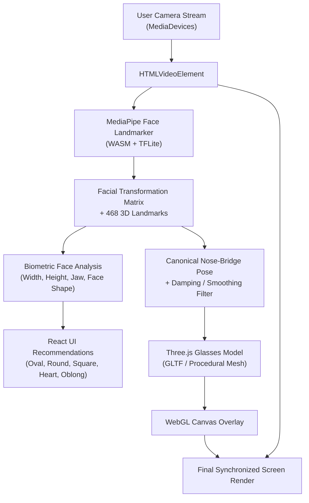

# Slow and Curious

> **Web-based Augmented Reality (AR) & 3D Commerce Experience**  
> *Seamless, zero-install 3D Virtual Try-On for eyewear and room-scale AR furniture placement, running entirely in the browser.*  
>  
> 📖 **Deep Dive Documentation:** For a complete file-by-file logic breakdown, 3D math, and code explanations, read [HOW_IT_WORKS.md](./HOW_IT_WORKS.md).

---

## 📌 Project Overview

**Slow and Curious** is an immersive e-commerce web platform engineered to bridge the gap between digital shopping and physical reality. It delivers high-fidelity, real-time spatial computing directly through modern web browsers—without requiring native mobile app installations or specialized hardware.

The platform combines two key experiential engines:
1. **Virtual Try-On (Eyewear)**: AI-powered facial tracking, real-time landmark detection, automatic biometric face-shape analysis, and 6-DOF 3D glasses fitting.
2. **Room AR & 3D Studio (Furniture & Decor)**: True-to-scale (1:1) spatial placement via WebXR surface hit-testing and camera raycasting, complemented by an interactive 3D studio with human scale references and upholstery customizers.

---

## 🎯 What Problem Does This Project Solve?

Online shopping for personal and spatial items (such as eyewear and home furniture) has historically suffered from high friction and high return rates (often 30–40% in e-commerce). The primary pain points addressed include:

- **The Visualization & Fit Gap**: Consumers struggle to gauge how a pair of glasses fits their unique face proportions (width, temple length, bridge height) or how a sofa will look inside their living room dimensions.
- **Sizing Uncertainty**: Static 2D product photos cannot communicate true physical scale, leading to products arriving too large or small for the customer's space or face.
- **App Store Download Friction (App Fatigue)**: Traditional AR retail experiences force users to download hefty native mobile applications (100MB+), complete registration forms, and grant intrusive permissions just to preview an item.
- **Cross-Platform Accessibility**: By leveraging **WebXR**, **WebRTC**, and **WASM-accelerated Computer Vision**, Slow and Curious makes spatial commerce universally accessible on any modern device (desktop, laptop, tablet, Android Chrome, and iOS Safari) with a single URL click.

---

## ✨ Key Features

### 🕶️ 1. Real-Time Eyewear Virtual Try-On (`/tryon`)
- **Real-Time Facial Landmark Tracking**: Powered by Google MediaPipe Face Landmarker, tracking 468+ facial landmarks at high frame rates.
- **Automated Biometric Face Diagnostic Scan**:
  - Automatically measures cheek-to-cheek width (cm), forehead-to-chin height (cm), and jaw width (cm).
  - Classifies face shape into **Oval**, **Round**, **Square**, **Heart**, or **Oblong**.
  - Dynamically computes Pupil Distance (PD) and facial metrics.
- **Personalized Frame Recommendations**: Suggests matching frame geometries and styling advice tailored to the user's detected facial anatomy.
- **6-DOF Canonical Pose Alignment & Damping**: Maps 3D eyewear models to the canonical nose-bridge coordinates with jitter-filtering and pose smoothing.
- **Adaptive Mobile Auto-Scaling**: Intelligently auto-adjusts frame scaling based on camera aspect ratios (desktop landscape vs. mobile portrait).
- **Interactive Fine-Tuning Controls**: Allows manual adjustment of frame scale, vertical elevation, and depth offset.
- **Procedural Photorealistic Fallback**: Includes custom procedural stub glasses with physical glass materials (transmission, roughness, IOR) if 3D assets are unavailable.

### 🛋️ 2. Room AR & Interactive 3D Studio (`/ar`)
- **WebXR Immersive Surface Placement**:
  - Leverages WebXR `immersive-ar` session with hit-testing against physical floors and planes (supported on Android Chrome with ARCore).
  - Real-time reticle tracking locked to physical surfaces.
- **Cross-Device Live Camera AR (Fallback Engine)**:
  - For devices without native WebXR, a custom camera stream raycasts onto a calibrated virtual floor plane.
  - Multi-touch gesture controls:
    - **Single-finger drag**: Reposition items across the room floor.
    - **Two-finger pinch**: Fine-scale resizing.
    - **Two-finger twist**: 360-degree rotation.
  - Elevation controls, surface locking, and camera flipping (environment vs. user facing).
- **Interactive 3D Studio Inspection Mode**:
  - 360-degree OrbitControls inspection with smooth damping.
  - **1.75m Human Silhouette**: Instant visual scale reference to understand true furniture proportions.
  - **Dynamic Dimension Bounding Box**: Displays live wireframe edge guides and metric measurements (width × height × depth in meters).
  - **Upholstery Customizer**: Real-time material finish switching (Bouclé Cream, Cognac Leather, Olive Velvet, Charcoal Wool, Terracotta Linen, and Original).
  - **Studio Lighting Presets**: Neutral Studio, Warm Interior, and Daylight environments.
- **AR Photo Snapshot**: Capture and download high-resolution photos of placed furniture inside your room.

### 🏠 3. Interactive Landing Experience (`/`)
- **3D Hero Turntable**: Interactive Three.js model viewer with drag-to-rotate pointer physics, inertia, and auto-rotation toggle.
- **Curated Catalog Showcase**: Smooth transition into Eyewear and Furniture collections.

---

## 🛠️ Tech Stack

| Category | Technology | Description |
|---|---|---|
| **Frontend Framework** | **React 19** | Reactive UI architecture with hooks, suspense, and lazy loading |
| **Language** | **TypeScript 5+** | Full strict type-safety across engines, types, and UI components |
| **Build & Dev Tool** | **Vite 8** | High-performance ES module bundler and local dev server |
| **Routing** | **React Router 7** | Client-side routing with clean URL navigation |
| **3D Engine & Graphics** | **Three.js (r186)** | WebGL rendering, GLTF/GLB asset loading, scene graph management, materials |
| **Computer Vision / AI** | **Google MediaPipe Tasks Vision (v1.1.1)** | WASM-powered Face Landmarker model (`face_landmarker.task`) |
| **AR & Sensors** | **WebXR Device API** | WebXR `immersive-ar`, hit-testing, dom-overlay, local-floor reference spaces |
| **Video & Camera** | **WebRTC `getUserMedia`** | Low-latency camera feeds for computer vision and camera AR |
| **Local HTTPS Tooling** | **`@vitejs/plugin-basic-ssl`** | Self-signed SSL certificate generation (required for camera/XR security) |
| **Styling** | **Modern CSS3** | Custom properties, responsive flexbox/grid, glassmorphic UI, animations |

---

## 🏛️ Architecture & Data Flow

### Architecture Layers

```
┌─────────────────────────────────────────────────────────────┐
│                    User Interface (React 19)                │
│   HomeView  │  TryOnView (Eyewear)  │  ArView (Furniture)   │
│   Collections  │  Shell Navigation  │  Fit/Studio Controls  │
└──────────────────────────────┬──────────────────────────────┘
                               │
┌──────────────────────────────▼──────────────────────────────┐
│                    Spatial Engine Layer                     │
│  ┌──────────────────────────────┐ ┌──────────────────────┐  │
│  │     TryOnEngine (index.ts)   │ │  ArEngine (index.ts) │  │
│  │  - MediaPipe Vision Pipeline │ │  - WebXR Session     │  │
│  │  - Face Landmark Detection   │ │  - Hit-Testing Loop  │  │
│  │  - Canonical Pose Matrix     │ │  - Floor Raycasting  │  │
│  │  - Biometric Shape Analyzer  │ │  - Multi-Touch Gest. │  │
│  │  - Pose Smoothing / Damping  │ │  - Reticle & Objects │  │
│  └──────────────┬───────────────┘ └──────────┬───────────┘  │
│                 │                            │              │
│                 ▼                            ▼              │
│  ┌───────────────────────────────────────────────────────┐  │
│  │           Three.js WebGL Scene Graph Engine           │  │
│  │  Perspective Cameras │ GLTFLoader │ Lighting Presets  │  │
│  │  MeshPhysicalMaterials │ Dimension Boxes │ Silhouettes│  │
│  └───────────────────────────────────────────────────────┘  │
└──────────────────────────────┬──────────────────────────────┘
                               │
┌──────────────────────────────▼──────────────────────────────┐
│                  Hardware & Browser APIs                    │
│   WebXR API (ARCore)  │  MediaDevices (getUserMedia)        │
│   MediaPipe WASM Runtime  │  WebGL 2.0 / Canvas             │
└─────────────────────────────────────────────────────────────┘
```

### End-to-End Try-On Data Flow



---

## 📂 Project Structure

```
See-yourself.-See-the-possibilities/
├── public/
│   ├── assets/
│   │   ├── frames/             # GLB 3D eyewear models (frame-01.glb .. frame-05.glb)
│   │   ├── furniture/          # GLB 3D furniture models (item-01.glb .. item-05.glb)
│   │   ├── thumbs/             # Rendered preview thumbnails for catalog items
│   │   └── CREDITS.md          # 3D model licenses and attribution records
│   ├── catalog/
│   │   ├── frames.json         # Eyewear catalog metadata (id, name, model, thumb)
│   │   └── furniture.json      # Furniture catalog metadata (dimensions, category, model)
│   └── models/
│       └── face_landmarker.task # MediaPipe Face Landmarker pre-trained model
├── src/
│   ├── app/
│   │   ├── App.tsx             # Root router, shell layout, and navigation
│   │   ├── main.tsx            # Application entry point
│   │   └── shell.css           # Global typography, header, footer, and shell styles
│   ├── features/
│   │   ├── ar/
│   │   │   ├── engine/
│   │   │   │   ├── index.ts    # WebXR AR Engine (hit-testing, sessions, placement)
│   │   │   │   ├── dev.ts      # Standalone AR testing script
│   │   │   │   └── dev.html    # AR Engine dev test harness
│   │   │   └── ui/
│   │   │       ├── ArView.tsx  # Furniture 3D studio, camera AR, and gestures
│   │   │       ├── arHelpers.ts# Human silhouette, dimension boxes, finishes
│   │   │       └── ar.css      # AR interface styles
│   │   ├── home/
│   │   │   ├── HomeView.tsx    # Landing page with interactive 3D hero showcase
│   │   │   ├── Collections.tsx # Catalog grid preview component
│   │   │   └── home.css        # Home page styles
│   │   └── tryon/
│   │       ├── engine/
│   │       │   ├── index.ts    # FaceLandmarker tracking, matrix math, 3D glasses
│   │       │   ├── dev.ts      # Standalone Try-On testing script
│   │       │   └── dev.html    # Try-On Engine dev test harness
│   │       └── ui/
│   │           ├── TryOnView.tsx # Camera feed, face diagnosis scan, fit controls
│   │           └── tryon.css   # Try-On interface styles
│   └── shared/
│       ├── catalog.ts          # Catalog fetch helpers
│       └── types.ts            # Core TypeScript interfaces (Frame, Furniture, Engines)
├── index.html                  # Main HTML entry template
├── package.json                # Project dependencies and npm scripts
├── tsconfig.json               # TypeScript compiler configuration
├── vercel.json                 # Vercel deployment routing configuration
└── vite.config.ts              # Vite configuration (HTTPS, port 6969, host: true)
```

---

## 🚀 How to Run the Project

### Prerequisites
- [Node.js](https://nodejs.org/) (version 18.0.0 or higher recommended)
- `npm` (bundled with Node.js)
- A device with a webcam (for desktop try-on) or a smartphone (Android with Chrome / iOS with Safari) on the same Wi-Fi network for AR testing.

### 1. Clone & Install Dependencies
```bash
git clone https://github.com/GowithKeya/See-yourself.-See-the-possibilities.git
cd See-yourself.-See-the-possibilities
npm install
```

### 2. Run the Development Server
```bash
npm run dev
```

The Vite dev server starts with HTTPS enabled using a self-signed certificate:
```
  ➜  Local:   https://localhost:6969/
  ➜  Network: https://<laptop-ip>:6969/
```

> **Why HTTPS?** Modern browsers strictly require a secure origin (`https://` or `localhost`) to access camera hardware (`getUserMedia`) and WebXR device APIs.

---

### 3. Open on Desktop
1. Open your browser and navigate to `https://localhost:6969`.
2. Because the dev server uses a local self-signed certificate, your browser will display a privacy/security warning:
   - **Chrome / Edge**: Click **"Advanced"** → **"Proceed to localhost (unsafe)"**.
   - **Firefox**: Click **"Advanced"** → **"Accept the Risk and Continue"**.
3. Allow camera permissions when prompted to use Virtual Try-On.

---

### 4. Open on a Smartphone (Mobile AR & Try-On)
To test **Room AR** or **Mobile Try-On** with your phone camera:
1. Connect your smartphone to the **same Wi-Fi network** as your development computer.
2. Find your computer's local IP address:
   - **Windows**: Run `ipconfig` in Command Prompt or PowerShell (look for *IPv4 Address*, e.g., `192.168.1.45`).
   - **macOS / Linux**: Run `ifconfig` or `hostname -I`.
3. Open your mobile browser (Google Chrome on Android, Safari on iOS) and navigate to:
   ```
   https://<laptop-ip>:6969
   ```
   *(Example: `https://192.168.1.45:6969`)*
4. Bypass the certificate warning (tap **"Advanced"** → **"Proceed"**).
5. Ensure your computer's firewall allows incoming connections on port `6969`.

---

### 5. Standalone Engine Dev Harnesses
For testing the underlying computer vision and AR engines in isolation without the full application shell:
- **Try-On Engine Dev Harness**:  
  `https://localhost:6969/src/features/tryon/engine/dev.html`
- **AR Engine Dev Harness**:  
  `https://localhost:6969/src/features/ar/engine/dev.html`

---

### 6. Build for Production
To generate an optimized production bundle:
```bash
npm run build
```
To preview the production build locally:
```bash
npm run preview
```

---

## 👥 Credits & Acknowledgments

### 3D Assets & Acknowledgments
- Third-party 3D models are sourced from the **[Khronos glTF-Sample-Assets](https://github.com/KhronosGroup/glTF-Sample-Assets)** repository under **CC BY 4.0** and **CC0 1.0** licenses, optimized and adapted for WebXR commerce standards.
- Detailed licensing and individual model attributions can be found in [`public/assets/CREDITS.md`](./public/assets/CREDITS.md).
